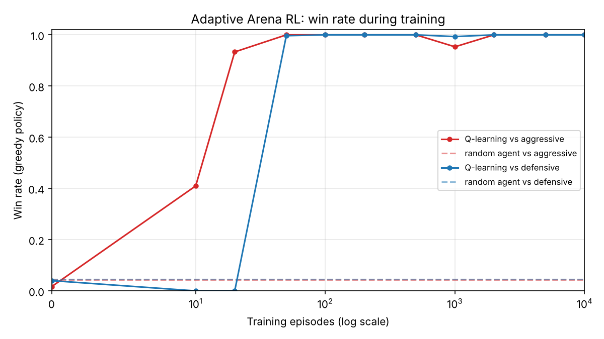

# Adaptive Arena RL

A Q-learning agent that learns to fight in a small 1D arena, written from scratch in Python with NumPy. No RL libraries.



*Win rate of the greedy policy while training. Dashed lines are a random agent. The x-axis is logarithmic because learning is fast.*

## What this is

Two fighters stand on a line of 10 cells. The agent (left) fights a scripted opponent (right) whose style, **aggressive** or **defensive**, is chosen at random each episode. Both act at the same time every step. The agent is never told the rules; it only sees the state and the reward, and has to work out a strategy by trial and error.

This is a clean rewrite of my earlier browser prototype (a JavaScript game with a hand-written neural network). I rewrote it because I found bugs in that version's learning code, and I wanted a version small enough to understand completely and verify with tests.

## The environment (`env.py`)

| Item | Definition |
|---|---|
| Actions | `left`, `right`, `attack`, `block` |
| Attack | Hits (1 HP) if the fighters are adjacent and the target is not blocking |
| Recovery | After attacking, a fighter is helpless for the next step (forced idle, cannot block). Attacking into a block therefore leaves you open |
| State | `(distance, my HP, opponent HP, opponent's last action, am I in recovery)`, 3,600 discrete states |
| Reward | +1 per damage dealt, −1 per damage taken, +10 win, −10 loss, −0.01 per step |
| Episode end | Someone reaches 0 HP, or 60 steps |

## The algorithm (`agent.py`)

Tabular Q-learning. The table `Q[state][action]` estimates the total future reward of taking an action in a state. After every step:

```
Q(s,a) ← Q(s,a) + α · ( r + γ · max Q(s',a')  −  Q(s,a) )
```

- `α = 0.1` learning rate, `γ = 0.95` discount
- ε-greedy exploration: ε decays from 1.0 to 0.05, so the agent explores early and exploits later
- Ties between equal Q-values are broken randomly (the table starts at zero)

## Results

Greedy policy, 2,000 evaluation episodes per opponent style, seed 0:

| Opponent | Random agent | Q-learning agent |
|---|---|---|
| Aggressive | 4% wins | 100% wins |
| Defensive | 5% wins | 100% wins |

It reaches ~100% within about 50 training episodes. I ran seeds 0–5 and all reached 100% against both styles.

### Why does it win so easily? (`analyze.py`)

The honest answer is that this game has a **dominant strategy**: *block, then counter-attack the moment the opponent attacks.* Because a fighter that attacks is helpless for one step, blocking makes every opponent attack a wasted one, and the counter-attack always lands.

- A hand-written "block then counter" policy wins **100%** against both styles.
- A naive "always attack" policy wins **0%** (it draws or loses).
- In the learned table, when the adjacent opponent has just attacked, the greedy action is `attack` in 73% of the visited states (22 states); otherwise it prefers `block` in 65% (46 states). The agent rediscovered the strategy on its own.

So the result shows the agent learns correctly, but the opponents are easy to beat once the idea is found. See limitations.

## Run it

```bash
pip install -r requirements.txt
python -m pytest          # 8 tests of the environment rules
python train.py           # trains (~5 s), saves results.png and q_table.npy
python demo.py            # watch an episode as ASCII (--style defensive also works)
python analyze.py         # the checks behind the "why does it win" section
```

Example `demo.py` output:

```
step  5   . . . . A O . . . .   HP 5 vs 5   agent: block  opp: block
step  6   . . . . A O . . . .   HP 5 vs 5   agent: block  opp: attack
step  7   . . . . A O . . . .   HP 5 vs 4   agent: attack opp: idle
```

## Project structure

```
env.py        arena rules, opponent styles, reset()/step()
agent.py      QAgent (the Q-learning update) and a RandomAgent baseline
train.py      training loop, evaluation, results.png
demo.py       ASCII replay of one episode
analyze.py    hand-written baselines and Q-table inspection
test_env.py   unit tests for the rules
```

## Limitations

- The environment is small and has a dominant strategy, so it does not stress the algorithm. The opponents are scripted and never learn.
- A Q-table only works because the state is tiny and discrete. It cannot handle continuous or high-dimensional states.
- Only two opponent styles are used, and the agent is not tested on unseen opponents.

## Future work

- Opponents that adapt, or a stamina rule so blocking has a cost, so no single strategy dominates
- Replace the table with a small neural network (DQN with experience replay and a target network)
- Self-play: train two learning agents against each other
- Evaluate on opponent styles held out from training
